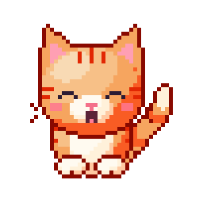
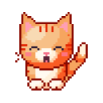
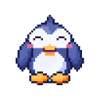
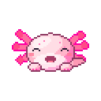

<p align="center">
  
</p>

<h1 align="center">Pixel Pals</h1>

<p align="center">
  <strong>Tiny pixel pets that live on your Windows desktop.</strong><br>
  Adopt a cozy tabby cat, a cheerful tuxedo penguin, or an aquatic axolotl.<br>
  They float above your windows, their eyes follow your mouse cursor everywhere,<br>
  and they keep you company with over a thousand messages, tricks, naps and treats.
</p>

<p align="center">
  <a href="https://github.com/1-Pankaj/Pixel-Pals/releases/latest"></a>
  <a href="https://1-pankaj.github.io/Pixel-Pals/"></a>
  <a href="LICENSE"></a>
  <a href="https://github.com/1-Pankaj/Pixel-Pals/actions/workflows/ci.yml"></a>
</p>

<p align="center">
  <a href="#-meet-the-pals">Meet the Pals</a> •
  <a href="#-how-to-play">How to Play</a> •
  <a href="#-quick-start">Quick Start</a> •
  <a href="#-installer--portable-builds">Download & Build</a> •
  <a href="#-how-it-works">How It Works</a> •
  <a href="#-pet-home-dashboard">Pet Home</a> •
  <a href="#-adding-custom-dialogue">Custom Dialogue</a> •
  <a href="#-tests">Tests</a>
</p>

---

<p align="center">
  
</p>

<p align="center">
  <em>Mochi, Waddle, and Axo tracking the cursor, doing tricks, enjoying snacks, and dangling with swing physics.</em>
</p>

---

## 🐾 Meet the Pals

<table>
  <tr>
    <td align="center" width="33%">
      <br>
      <h3>Mochi</h3>
      <p><b>Tabby Cat</b> • <i>The Cozy Napper</i></p>
    </td>
    <td align="center" width="33%">
      <br>
      <h3>Waddle</h3>
      <p><b>Penguin</b> • <i>The Slide Specialist</i></p>
    </td>
    <td align="center" width="33%">
      <br>
      <h3>Axo</h3>
      <p><b>Axolotl</b> • <i>The Smiling Water Dragon</i></p>
    </td>
  </tr>
  <tr>
    <td valign="top">
      <ul>
        <li><b>Habitat:</b> Sunlit room with wooden floorboards, yarn ball, and woven pink rug</li>
        <li><b>Traits:</b> Cuddly, curious, loaf-prone</li>
        <li><b>Favorite Treat:</b> Fish 🐟</li>
        <li><b>Signature Move:</b> Ear twitches, tail swishes, and deep purrs</li>
      </ul>
    </td>
    <td valign="top">
      <ul>
        <li><b>Habitat:</b> Mountain tundra with snowdrifts, pebble stones, and falling snow</li>
        <li><b>Traits:</b> Cheerful, loyal, slidey</li>
        <li><b>Favorite Treat:</b> Fish 🐟</li>
        <li><b>Signature Move:</b> Wing flappings, sliding dances, and gifting pebbles</li>
      </ul>
    </td>
    <td valign="top">
      <ul>
        <li><b>Habitat:</b> Aquatic lagoon with sunbeam caustics, swaying seaweed, and air bubbles</li>
        <li><b>Traits:</b> Gentle, smiley, wiggly</li>
        <li><b>Favorite Treat:</b> Shrimp 🦐</li>
        <li><b>Signature Move:</b> Frilly gill pulses, bubble blowing, and hydration reminders</li>
      </ul>
    </td>
  </tr>
</table>

---

## 🕹️ How to Play

You can interact with your pal directly on your desktop or via the system tray:

| Action | What happens |
|:---|:---|
| **Move mouse anywhere** | Eyes follow your cursor across the entire screen, even outside the pet window |
| **Click the pet** | Hearts burst out, accompanied by a sound and friendly thought. Click fast to make them dizzy! |
| **Double-click** | Triggers a trick: 360° backflip, happy bounce, or a dance |
| **Click and drag** | Picks the pet up. It dangles and swings with cursor momentum, landing with an elastic squish |
| **Right-click** | Opens the menu: treat, trick, nap, jokes, facts, switch pal, size, chattiness, and settings |
| **Leave mouse idle** | The pet yawns, curls up, and takes a cozy nap with floating "Z"s. Moving the cursor wakes it up |
| **System tray icon** | Click to toggle visibility. Right-click to summon your pal back to the bottom-right corner |

> **Non-intrusive by design:** The pet sits in a frameless, transparent window. Empty space around the sprite is click-through, so it never steals keyboard focus from your IDE, browser, terminal, or games.

---

## ⚙️ How It Works

* 🎨 **100% Procedural Pixel Software Rasterizer (`Pixel`)**<br>
  No static PNG sprite sheets or font files are shipped. Every sprite, shadow ramp, outline, and expression is drawn in code via a tiny, custom software rasterizer. Sprites scale cleanly in whole device pixels on any DPI.
* 👀 **Global Multi-Monitor Cursor Tracking**<br>
  The Electron main process polls mouse coordinates globally, allowing the pet's gaze to follow your cursor naturally across multiple monitors without bringing the window to the foreground.
* 💬 **1,000+ Shuffled Dialogue Lines**<br>
  Messages come from shuffled bags that remember what you've seen so lines don't repeat. Covers time-of-day greetings, weekdays, calendar holidays (`MM-DD`), animal trivia, wholesome jokes, and gentle wellness nudges.
* 🧲 **Organic Physics Rig (`Brain`)**<br>
  Features dragging inertia, dangling state, swing angles calculated from cursor velocity, gravity, elastic squash-and-stretch on landing, and smooth roaming along screen edges.
* 🔊 **Zero-Asset WebAudio Sound Engine**<br>
  All sound effects (purrs, beeps, chirps, crunches) are synthesized in real-time using WebAudio oscillators, bandpass filters, and gain envelopes.
* 🔒 **100% Offline & Private**<br>
  No cloud servers, no user accounts, no telemetry, no analytics, and no internet connection required.

---

## 🏡 Pet Home Dashboard

Open **Pet Home** from the system tray or right-click menu to customize your companion:

<div align="center">
  <kbd><b>Pet Selector</b></kbd> • <kbd><b>Size (Small / Medium / Large)</b></kbd> • <kbd><b>Chattiness Level</b></kbd> • <kbd><b>Roaming</b></kbd> • <kbd><b>Sound Toggles</b></kbd> • <kbd><b>Wellness Nudges</b></kbd>
</div>

<br>

* **Pet Switcher:** Adopt Mochi, Waddle, or Axo with live animated habitat previews.
* **Size:** Small (3×), Medium (4× default), or Large (5×). Whole-pixel scaling prevents blurriness.
* **Chattiness:** Silent, Quiet (occasional thoughts), Normal, or Chatty.
* **Behavior Toggles:** Always on top, roam around screen edges, look at cursor, sleep when idle, wellness reminders (water, stretch, rest eyes), fun facts & jokes, synthesized sounds, and launch at login.

Settings are saved locally and atomically in your user data directory as `settings.json`.

---

## 🚀 Quick Start

### Prerequisites
You need [Node.js](https://nodejs.org) 18 or newer installed on your machine.

### Installation

```bash
# 1. Clone the repository
git clone https://github.com/1-Pankaj/Pixel-Pals.git
cd Pixel-Pals

# 2. Install dependencies
npm install

# 3. Launch Pixel Pals
npm run desktop
```

Your new companion appears in the bottom-right corner of your desktop, and the **Pet Home** window opens automatically on first launch so you can pick your favorite buddy.

---

## 📦 Installer & Portable Builds

To build standalone Windows executables:

```bash
# Generate dynamic icons and build Windows installer + portable exe
npm run dist

# Or build an unpacked directory for fast local testing
npm run dist:dir
```

Build outputs are saved to `dist/`:
* `Pixel Pals Setup 2.0.0.exe` — Full Windows installer with start menu and desktop shortcuts.
* `Pixel Pals-portable-2.0.0.exe` — Single standalone portable `.exe` (runs without installation).

### Verification & SHA-256 Checksums

| Binary Asset | Size | SHA-256 Checksum |
|:---|:---|:---|
| `Pixel Pals Setup 2.0.0.exe` | 114 MB | `871b86ae84918d5a10482b668cb52c44d4ee6ec69b8e8b7f765f5be6408edc26` |
| `Pixel Pals-portable-2.0.0.exe` | 104 MB | `d2c12739fef859185d9c2e074976c16756714faeb158d1dcb5c26b18116b3bdf` |

*(Note: Windows SmartScreen may show an "Unrecognized app" prompt on first launch for independent open-source apps. Click **More info** → **Run anyway**. Builds are unsigned, so verifying the SHA-256 hash confirms binary integrity.)*

### Platform Support
Pixel Pals is built and tested for **Windows 10 and 11** (64-bit). The underlying procedural rasterizer and state machine run on plain JavaScript and standard Web APIs; macOS and Linux desktop packaging are currently untested, and PRs are welcome!

---

## 📂 Project Structure

```
pixel-pals/
├── src/
│   ├── main/                 # Electron main process
│   │   ├── main.js           # Transparent window, cursor tracking, tray, roaming, IPC
│   │   ├── preload.js        # Safe context bridge
│   │   └── settings.js       # Atomic JSON settings store
│   ├── renderer/             # Frontend windows
│   │   ├── pet.html/css/js   # Floating desktop pet, speech bubble, organic physics
│   │   └── home.html/css/js  # Pet Home dashboard & animated habitat preview
│   └── shared/               # Core engine (runs in Node and browser)
│       ├── pixel.js          # Software pixel rasterizer (cel-shading, outlines, ramps)
│       ├── pets.js           # Procedural sprite models for Mochi, Waddle, and Axo
│       ├── brain.js          # State machine, physics, sleep, roaming, reactions
│       ├── effects.js        # Hearts, stars, bubbles, and sleep particles
│       ├── scenes.js         # Animated habitat backgrounds
│       ├── sound.js          # Synthesized WebAudio sound effects
│       ├── icons.js, png.js  # Procedural icon generator
│       └── messages/         # 1,000+ dialogue lines in shuffled bags
├── scripts/
│   ├── selftest.js           # 175-check test suite (lifetime simulation)
│   ├── preview.js            # Generates preview of all pet expressions
│   ├── make-icons.js         # Generates build/icon.ico and icon.png
│   └── record-demo.py        # Automated GIF recorder for documentation
├── website/                  # Live showcase website with habitat canvases
├── docs/                     # GitHub Pages deployment mirror
└── build/                    # Generated application and installer icons
```

---

## 💬 Adding Custom Dialogue

Dialogue files are neatly split into categories under `src/shared/messages/`:
* `core.js`: Greetings, time of day, weekdays, calendar dates (`MM-DD`), and petting reactions.
* `shared.js`: Encouragement, care reminders, work focus, and compliments.
* `facts.js`: Animal facts, trivia, and wholesome jokes.
* `mochi.js`, `waddle.js`, `axo.js`: Individual character voices.

To add your own lines, open any of these files and append a string or an expression-tagged tuple:

```javascript
"Enjoying the afternoon breeze.",
["Look what I found for you!", "happy"]
```

Available expression tags: `happy`, `love`, `wide`, `sleepy`, `sad`, `dizzy`, `squint`, `glad`, `calm`.

---

## 🐣 Adding a New Pet

1. In `src/shared/pets.js`, write a procedural drawing function (you can use `drawAxo` or `drawMochi` as a reference) and register it in `PETS`.
2. Create `src/shared/messages/yourpet.js` and register it in `src/shared/messages/index.js` and in `<script>` tags in `pet.html` and `home.html`.
3. Add an animated habitat scene in `src/shared/scenes.js`.
4. Run `npm test` to validate your new pet's lifetime simulation.

The Pet Home adoption dashboard, tray menu, and switcher will automatically detect the new pet.

---

## 🧪 Tests

Pixel Pals includes a built-in automated verification suite:

```bash
# Run the 175-check lifetime simulation suite
npm test
```

This runs:
* 2 hours of virtual life simulation per pet (verifying movement, speech, napping, and waking)
* Validation of all 1,089 message lines, shuffle bags, and expression tags
* Verification of the atomic settings store and procedural icon generators
* Mock testing of the Electron main process IPC and window lifecycles

To run the Playwright website test suite:
```bash
python website/test_website.py
```

---

## 💖 Contributing

Contributions, dialogue additions, translations, and new pets are always welcome! Feel free to check out [CONTRIBUTING.md](CONTRIBUTING.md) and open a pull request or issue.

---

## 📄 License

Pixel Pals is open source software licensed under the [MIT License](LICENSE).<br>
Made with love for cozy desktops everywhere.
