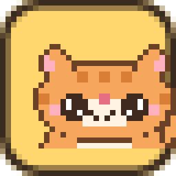
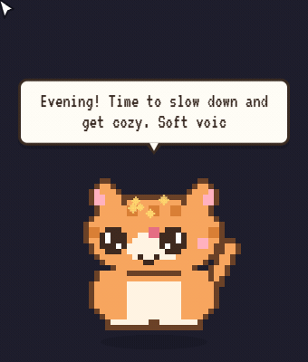
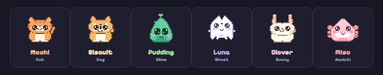

# Pixel Pals

<p align="center">
  
</p>

<p align="center">
  <strong>A cozy pixelated desktop companion that lives on top of your windows.</strong><br>
  Adopt one of six handcrafted pals with global mouse-tracking eyes, 2,500+ dialogue lines, interactive choice questions, mini-games, snack feeding, breathing breaks, focus timers, and a live synthesized sound engine.
</p>

<p align="center">
  <a href="https://github.com/1-Pankaj/Pixel-Pals/actions/workflows/ci.yml"></a>
  <a href="https://github.com/1-Pankaj/Pixel-Pals/releases"></a>
  <a href="LICENSE"></a>
  <a href="https://github.com/1-Pankaj/Pixel-Pals"></a>
  <a href="https://github.com/1-Pankaj/Pixel-Pals/discussions"></a>
  <a href="CONTRIBUTING.md"></a>
</p>

<p align="center">
  
</p>

---

## The Six Pals

<p align="center">
  
</p>

| Pal | Species | Personality & Quirks |
|:---|:---|:---|
| **Mochi** | Orange Tabby | Professional napper. Judgy about your playlist, but loves you anyway. |
| **Biscuit** | Shiba Inu | Maximum loyalty, minimum chill. Will do backflips for any snack. |
| **Pudding** | Mint Slime | Small, squishy, bouncy, and full of gelatinous dreams. |
| **Luna** | Little Ghost | Cozy hovering vibes. Floats gently above your desktop without haunting. |
| **Clover** | Bunny | High-altitude ears, soft heart, and rapid-fire hops. |
| **Miso** | Axolotl | Perpetual cheerful grin. Scientifically incapable of frowning. |

Each buddy features custom 32×32 pixel art, 5 distinct facial expressions, wagging tails, sway overlays, and **40 unique personality lines** in addition to the shared message pool.

---

## Core Highlights

- 🫧 **Transparent & Non-Intrusive**: Always-on-top, frameless window with forward mouse-event pass-through. Clicks fall through everywhere except the pet and active choice bubbles, so it never interrupts your work.
- 👀 **Global Eye Tracking**: Your pal's eyes follow your mouse cursor across any monitor, even when working inside other applications.
- 💬 **2,500+ Handcrafted Messages**: No AI, no cloud accounts, and zero subscriptions. Time-aware greetings (morning, afternoon, evening, night), weekday/weekend quips, trivia, shower thoughts, and anti-repeat shuffle bags.
- 🎯 **Interactive Question Bubbles**: The pet asks *you* questions. The speech bubble expands with clickable buttons for Yes/No dilemmas, This-or-That, three-choice Trivia, and emotional check-ins.
- 🎲 **Mini-Games**: Play Rock-Paper-Scissors with drumroll reveals, flip coins, shake the Magic 8-Ball, or go through multi-step Knock-Knock jokes.
- 🍪 **Snack Time**: Feed your buddy a cookie, donut, or boba cup. Features 3 animated crunchy bites, crumbs, and mood boosts.
- 🔊 **Zero-Asset WebAudio Synthesizer**: No external audio files. Sounds are synthesized live through custom oscillator nodes, filtered noise bursts, lowpass filters, and compressors for soft, warm, kawaii-game tones.
- ⏱️ **Gentle Productivity & Wellness**: Main-process focus timers (15/25/50 min), countdown alarms, guided 1-minute 4-4-4 breathing exercises, water reminders, and stretch nudges.
- 🧲 **Fling Physics**: Pick up and drag your pal with 1:1 cursor follow. Flinging calculates release velocity and adds gravity with elastic screen-edge bouncing.

---

## Controls

### Mouse Gestures

| Action | Result |
|:---|:---|
| **Single click** | Poke reaction: jump, giggle, spin, or squish (3 quick pokes triggers dizzy stars) |
| **Double click** | Dance party! Wiggle animation + music notes |
| **Hold (≈0.5s)** | Squish! Squeezes the pet with bursting hearts |
| **Drag** | Pick it up — dangles with wide eyes (speech bubble stays anchored to the head) |
| **Shake during drag** | Rapidly wiggle cursor left and right to make the pet dizzy on drop |
| **Fling** | Fast drag + release launches the pet with bouncy edge collisions |
| **Tickle** | Wiggle cursor over the pet to trigger a giggle fit |
| **Scroll wheel** | Scroll up = happy hops; Scroll down = squish flat |
| **Right click** | Open in-game context menu (feed, question, dance, focus, nap, switch pal) |
| **System Tray** | Access all settings, timers, reminders, pal switching, or quit |

### Global Keyboard Shortcuts

Because the pet window intentionally avoids stealing window focus, interactions can be triggered system-wide via keyboard shortcuts (toggleable in tray):

| Shortcut | Action |
|:---|:---|
| `Alt+Shift+P` | Pet (burst hearts) |
| `Alt+Shift+B` | Say something |
| `Alt+Shift+F` | Drop a snack |
| `Alt+Shift+D` | Start dance party |
| `Alt+Shift+N` | Toggle nap / wake |
| `Alt+Shift+T` | Ask current time |
| `Alt+Shift+S` | Hangout statistics |
| `Alt+Shift+Q` | Ask a random question |
| `Alt+Shift+R` | Rock, Paper, Scissors |
| `Alt+Shift+C` | Flip a coin |
| `Alt+Shift+M` | Ask Magic 8-ball |
| `Alt+Shift+K` | Tell a knock-knock joke |
| `Alt+Shift+Y` | Tell a 3-part story |
| `Alt+Shift+E` | Guided breathing break (1 min) |
| `Alt+Shift+G` | Start 25-minute focus timer |
| `Alt+Shift+H` | Stop focus timer |
| `Alt+Shift+1` / `2` / `3` | Answer open question choice 1, 2, or 3 |
| `Alt+Shift+X` | Dismiss bubble / question |

---

## Getting Started

### Option 1: Download Pre-built Executable (Windows)

Visit the [Releases](https://github.com/1-Pankaj/Pixel-Pals/releases) page to download:
- **`Pixel Pals.exe`** — Standalone portable version (no installation needed, run directly).
- **`Pixel Pals Setup.exe`** — Standard Windows installer.

### Option 2: Run from Source

**Prerequisites**: [Node.js](https://nodejs.org/) 18 or higher.

```bash
# Clone repository
git clone https://github.com/1-Pankaj/Pixel-Pals.git
cd Pixel-Pals

# Install dependencies
npm install

# Launch desktop app
npm run desktop
```

On first launch, the **Adopt-a-Buddy** picker window opens. Select your buddy to spawn them on your desktop!

---

## Project Architecture

```
Pixel-Pals/
├── main.js              # Electron main process (lifecycle, physics, timers, tray, shortcuts)
├── preload.js           # Safe contextBridge IPC layer
├── assets/
│   ├── icon.ico/.png    # App icons
│   ├── tray-*.png       # System tray icons for each pet
│   ├── demo.gif         # Showcase animation
│   ├── pals-banner.png  # Character lineup banner
│   └── fonts/           # Local WOFF2 pixel fonts (Pixelify Sans, Press Start 2P, VT323)
├── src/
│   ├── pet.html/css/js  # Pet window: DPR canvas, state machine, particles, choice bubbles
│   ├── picker.html/css/js # Adopt-a-buddy window with live preview rendering
│   ├── sprites.js       # Hand-authored 32x32 sprite generator & palette tables
│   ├── sounds.js        # Pure WebAudio synthesizer (zero audio assets)
│   ├── messages.js      # Core greetings, idle lines, pet personalities
│   ├── messages-fun.js  # Jokes, facts, stories, knock-knock jokes
│   ├── messages-react.js# Interaction reactions (petting, flinging, naps, timers)
│   └── messages-ask.js  # Questions, trivia, games (RPS, coin, 8-ball)
└── test/                # Test harnesses, validation suites, and recorders
```

### Technical Highlights
- **Bubble Anchoring**: The speech bubble is anchored by a GPU-composited CSS `transform` on `#bubble-anchor` updated per frame, cleanly decoupled from layout styling. This completely prevents the bubble from sliding or trailing behind during window drags.
- **DPR Scaling**: Canvas dimensions and transforms dynamically respect `window.devicePixelRatio`, ensuring crisp pixel art on high-DPI displays (125%–200% Windows scaling).
- **Main-Process Timers**: Pomodoro and countdown timers run directly in Electron's main process, surviving renderer reloads without losing time.
- **Memory Footprint**: Offscreen canvases pre-bake pet layer frames once at startup, keeping idle CPU usage near 0%.

---

## Development Scripts

| Command | Purpose |
|:---|:---|
| `npm run desktop` | Run the desktop app |
| `npm run dev` | Run the app with detached DevTools enabled |
| `npm test` | Run the automated message validation suite |
| `npm run preview:sprites` | Render full sprite sheet of all pet frames to `out/sprites.png` |
| `npm run preview:app` | Launch the adopt-a-buddy picker in standalone preview mode |
| `npm run record:gif` | Run automated headless demo recorder to compile `assets/demo.gif` |
| `npm run dist` | Build Windows NSIS installer and portable `.exe` with electron-builder |
| `npm run dist:portable` | Build only the portable `.exe` binary |

---

## Community & Discussions

- Have questions, feature suggestions, or custom pet ideas? Head over to **[GitHub Discussions](https://github.com/1-Pankaj/Pixel-Pals/discussions)**!
- Found a bug? Open a structured report using our **[Bug Report Form](https://github.com/1-Pankaj/Pixel-Pals/issues/new?template=bug_report.yml)**.
- Want to contribute? Check out our **[Contributing Guide](CONTRIBUTING.md)** and **[Code of Conduct](CODE_OF_CONDUCT.md)**.

---

## License

This project is licensed under the [MIT License](LICENSE).

Bundled pixel fonts are open-source under the SIL Open Font License 1.1. See [CREDITS.md](CREDITS.md) for full font notices and designer credits.
